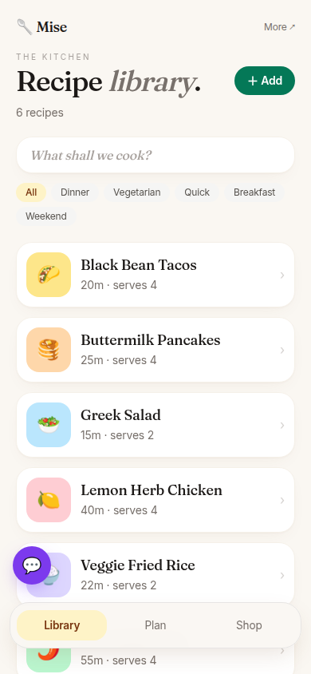
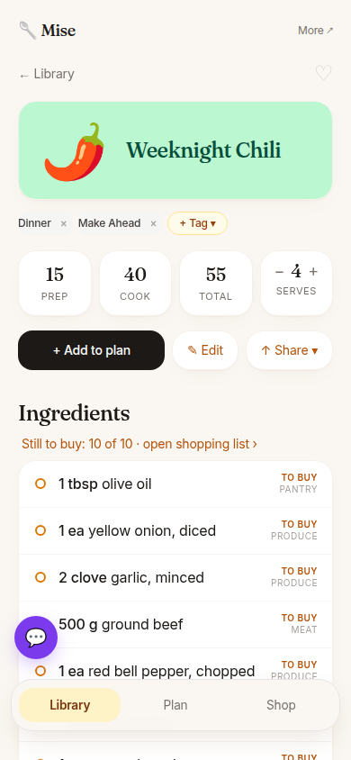
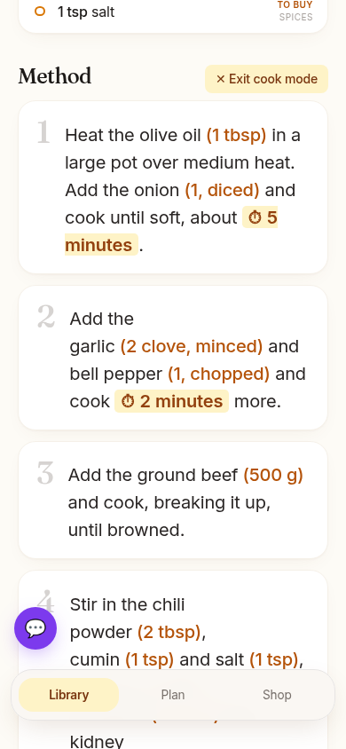
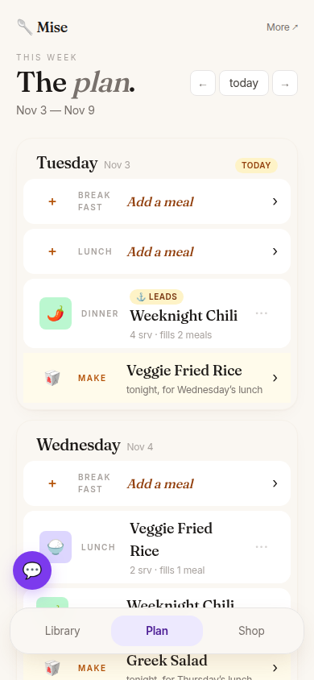
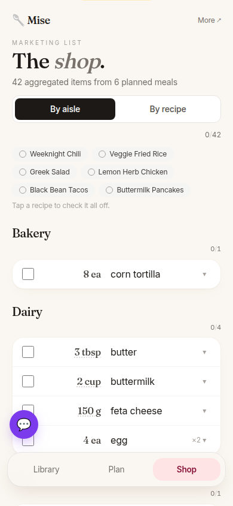
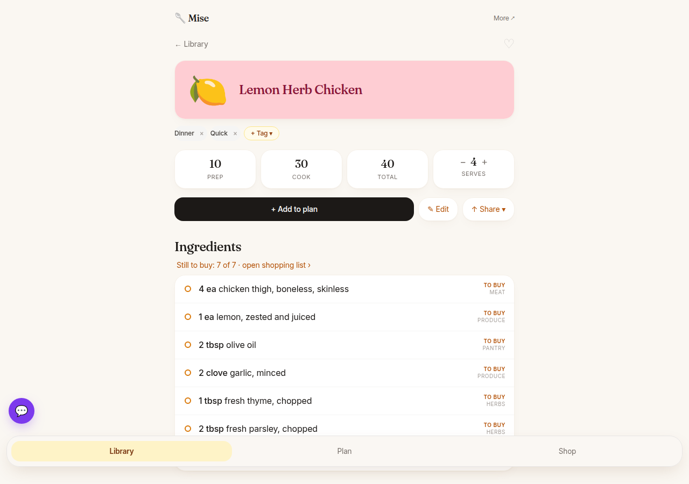

# Mise

A self-hosted meal planner for a household: keep your recipes in one place, plan the week, and get one shopping list sorted by aisle.

- **Recipe library.** Paste a link from a recipe site and Mise pulls in the ingredients and steps for you to check. Or type a recipe in. Tag recipes and filter by tag.
- **Week plan.** Put a recipe on a day. Big recipes fill the next meals with leftovers automatically.
- **Shopping list.** Everything you've planned, added up and grouped by aisle ("2 onions", not "1 onion + 1 onion"). Tick items off as you shop, or tick off a whole recipe at once.
- **Cook mode.** Shows each step with its amounts inline ("add the garlic (2 cloves, minced)") plus tap-to-start timers, so you don't scroll back to the ingredient list.
- **Works on a phone.** Add it to your home screen and it behaves like an app.
- **Your data stays on your computer.** One small database file, plus a plain-text copy of every recipe.

It runs with Docker, a free tool that runs ready-made software packages ("containers") with one command.

## Screenshots

All recipes below are made-up samples from `samples/seed.py`.

<table>
  <tr>
    <td></td>
    <td></td>
    <td></td>
  </tr>
  <tr>
    <td align="center">Recipe library</td>
    <td align="center">A recipe, with what you still need to buy</td>
    <td align="center">Cook mode: amounts and timers in each step</td>
  </tr>
  <tr>
    <td></td>
    <td></td>
    <td></td>
  </tr>
  <tr>
    <td align="center">Week plan, with leftovers filled in</td>
    <td align="center">Shopping list by aisle</td>
    <td></td>
  </tr>
</table>

On a computer:



## Setting it up

### 1. Install Docker

Install [Docker Desktop](https://docs.docker.com/get-docker/) (Mac or Windows) or Docker Engine (Linux), and start it.

### 2. Download Mise

```bash
git clone https://github.com/GraemeCrawley/mise.git
cd mise
```

### 3. Settings

```bash
cp .env.example .env
```

Open `.env` in a text editor. Set `TZ` to your timezone (for example `Europe/London` or `America/New_York`). Everything else can stay as it is. See the notes in the file for the optional `ANTHROPIC_API_KEY`.

### 4. Start it

```bash
docker compose up -d --build
```

The first build takes a few minutes. Then open **http://localhost:8000/app/**.

### 5. (Optional) Load the sample recipes

```bash
python3 samples/seed.py http://localhost:8000
```

This adds six made-up recipes and plans a few meals this week, so you can try everything. Load it only into a fresh install: to clear it out later you start over with `docker compose down -v`, which deletes all data.

### 6. Add your own recipes

Tap **＋ Add** in the library. Paste a link to a recipe page or the recipe text, and Mise makes a draft. Check it on the review screen and save. On an iPhone, the Add page explains how to add a "Send to Mise" button to the share sheet.

## Using it from your phone

By default Mise only answers on the computer it runs on. To reach it from your phone:

- **At home:** set `MISE_BIND=0.0.0.0` in `.env`, run `docker compose up -d` again, and open `http://<your computer's local IP>:8000/app/` on the phone.
- **Away from home:** use a private network such as [Tailscale](https://tailscale.com/), or a reverse proxy that asks for a login (for example Cloudflare Access).

**Mise has no login of its own.** Anyone who can reach it can see and change everything, so never expose it directly to the internet.

On the phone, use **Share → Add to Home Screen** to get an app icon.

## Backing up your data

- Your recipes, plans and lists live in a Docker volume (`mise_data`). Mise also keeps rolling snapshots of the database inside it.
- Every saved recipe is also written as a JSON file to `./recipes-export/`. Keep that folder in a private git repo, or copy it somewhere safe, and you have a readable backup.

## Updating

```bash
git pull
docker compose up -d --build
```

Database changes apply automatically on start.

## For developers

Python 3.12, FastAPI, SQLModel, Alembic and SQLite, managed with [uv](https://docs.astral.sh/uv/). The pages are rendered on the server; there's no front-end build step.

```bash
uv sync
uv run alembic upgrade head
uv run uvicorn mise.main:app --reload     # http://localhost:8000/app/
uv run pytest -q
```

- `mise/services/`: the logic (ingredient parsing, shopping-list maths, planner, cook-mode step matching).
- `mise/adapters/rest/`: the web pages and JSON API (interactive docs at `/docs`).
- `docs/`: notes on ingredient parsing, the data model and where Claude is used.

AI coding agents: see [AGENTS.md](AGENTS.md).

## License

MIT. See [LICENSE](LICENSE).
